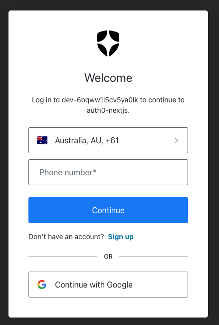
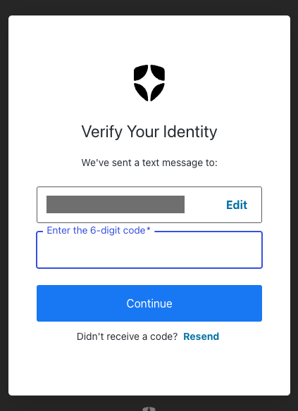
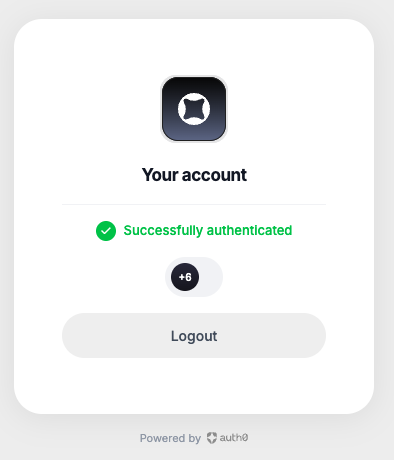

# Auth0 Passwordless Login (Next.js)

A Next.js app with passwordless sign-in through Auth0 Universal Login: users enter their phone number or email, receive a one-time code, and are signed in without a password.

The live demo currently has SMS enabled; email is configured and can be switched on in the Auth0 dashboard.

**Live demo:** https://auth0-nextjs-ochre.vercel.app/

Built with Next.js 16 (App Router), React 19, TypeScript, Tailwind CSS and the [Auth0 Next.js SDK](https://github.com/auth0/nextjs-auth0) v4. Deployed on Vercel.

## Features

- Passwordless sign-in with an SMS or email one-time code via Auth0 Universal Login
- Protected home page: a server-side session check redirects unauthenticated users to `/auth/login`
- Auth routes (`/auth/login`, `/auth/callback`, `/auth/logout`) handled by the Auth0 middleware in `src/proxy.ts`
- Displays the signed-in user's profile

## Screenshots

| Sign in | Enter code | Signed in |
| --- | --- | --- |
|  |  |  |

## Auth0 Tenant Configuration

Passwordless login is configured in the Auth0 dashboard rather than in code:

1. **Application:** create a Regular Web Application.
   - Allowed Callback URLs: `http://localhost:3000/auth/callback`, `https://auth0-nextjs-ochre.vercel.app/auth/callback`
   - Allowed Logout URLs: `http://localhost:3000`, `https://auth0-nextjs-ochre.vercel.app`
2. **Passwordless connections:** under Authentication → Passwordless, set up **SMS** (with its SMS provider settings) and **Email** (one-time code).
3. **Choose the login method:** on a connection's Applications tab, turn it on for this application. With SMS enabled, Universal Login shows a phone number prompt; with Email enabled, it shows an email prompt. The demo has SMS on and Email off.

## Getting Started

### 1. Install dependencies

```bash
npm install
```

### 2. Configure environment variables

Create a `.env.local` file in the project root with your Auth0 application credentials:

```bash
AUTH0_DOMAIN=
AUTH0_CLIENT_ID=
AUTH0_CLIENT_SECRET=
AUTH0_SECRET=
APP_BASE_URL=http://localhost:3000
```

See the [Auth0 Next.js SDK docs](https://github.com/auth0/nextjs-auth0) for how to obtain these values.

### 3. Run the dev server

```bash
npm run dev
```

Open [http://localhost:3000](http://localhost:3000) in your browser.

## Project Structure

- `src/app` - App Router pages and layout
- `src/components` - Login/logout buttons and profile display
- `src/lib/auth0.ts` - Auth0 client instance
- `src/proxy.ts` - Auth0 middleware for handling auth routes
